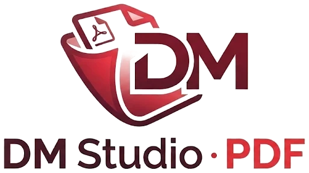

<p align="center"></p>

# DM Studio · PDF

Editor de PDF para Windows que funciona sin internet, sin cuenta y sin enviar tus archivos a ningún sitio.
Se usa como programa de escritorio (`DM Studio PDF.exe`) o en el navegador.

## Qué hace

- **Ver y leer:** una o dos páginas, modo lectura, leer en voz alta, buscar, marcadores, adjuntos, capas.
- **Editar el PDF de verdad:** cambiar texto (palabra, línea o párrafo), mover bloques, borrar texto, imágenes y formas del archivo, superíndice y subíndice.
- **Comentar y firmar:** notas, resaltado, dibujo, formas, sellos, firma e iniciales.
- **Formularios:** rellenarlos, crearlos y detectar los campos automáticamente.
- **Páginas:** organizar, girar, insertar, duplicar, recortar, numerar (i, ii, 1, 2…), dividir, invertir.
- **Convertir:** a Word, Excel, PowerPoint, imágenes, texto, HTML, Markdown y RTF; y de esos formatos a PDF.
- **Proteger:** contraseña, quitar información oculta, redactar de verdad y auditar redacciones.
- **OCR** en español e inglés, **comparar** dos PDF, **procesar muchos archivos a la vez**, pestañas y guardado automático.

## Cómo usarlo

- **Programa de escritorio:** descarga `DM-Studio-PDF-Windows.zip` desde *Releases*, descomprímelo y abre `DM Studio PDF.exe`. No se instala nada: usa WebView2, el motor web que ya trae Windows 10/11.
  Si Windows muestra «Windows protegió su PC», pulsa *Más información* ▸ *Ejecutar de todas formas* (pasa con programas nuevos sin firma digital).
- **En el navegador:** abre `app/Abrir DM Studio PDF.bat` (necesita Python) y se abrirá en `http://localhost:5173`.

## Estructura

```
app/          la aplicación (HTML, CSS y JavaScript) y sus librerías en app/vendor
escritorio/   el programa de Windows: Program.cs, compilar.ps1, icono/ y webview2/
```

## Compilar el .exe

Clic derecho en `escritorio/compilar.ps1` ▸ *Ejecutar con PowerShell*.
Usa el compilador de C# que trae Windows (.NET Framework 4), no hace falta instalar nada.
El resultado queda en `escritorio/dist/`: la carpeta `DM Studio PDF` (programa, librerías de WebView2 y la app) y el ZIP para publicar.

## Librerías de terceros

| Librería | Uso | Licencia |
|---|---|---|
| [pdf.js](https://github.com/mozilla/pdf.js) | mostrar los PDF | Apache-2.0 |
| [pdf-lib](https://github.com/Hopding/pdf-lib) y fontkit | escribir los PDF | MIT |
| [MuPDF.js](https://mupdf.com) | borrado real, cifrado | AGPL-3.0 |
| [Tesseract.js](https://github.com/naptha/tesseract.js) | OCR | Apache-2.0 |
| [Typo.js](https://github.com/cfinke/Typo.js) y diccionario español | ortografía | BSD / ver `app/vendor/dict` |
| Fuentes Liberation | texto editado | SIL OFL 1.1 |
| Microsoft WebView2 SDK | ventana del programa | licencia del SDK de Microsoft (redistribuible) |

## Licencia

DM Studio · PDF se publica bajo la licencia **GNU AGPL-3.0** (ver [LICENSE](LICENSE)), la que exige MuPDF.
Puedes usarlo, estudiarlo, modificarlo y compartirlo; si distribuyes una versión modificada, debes compartir también su código bajo la misma licencia.
Cada librería de terceros conserva su propia licencia (tabla de arriba).
